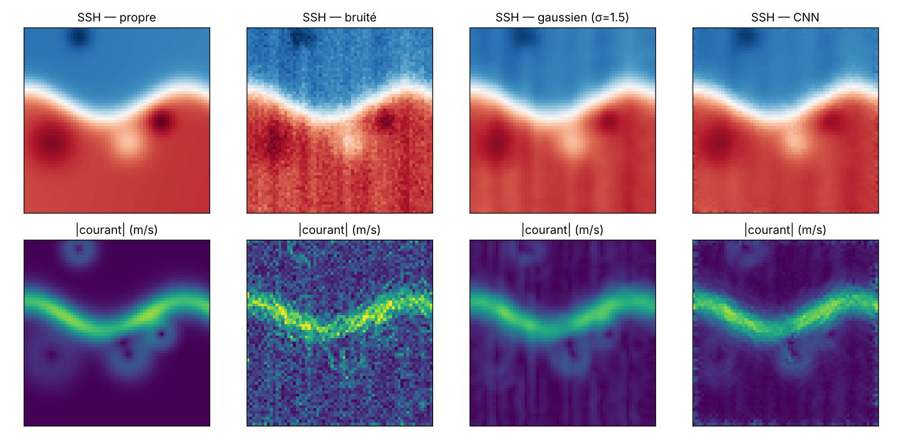

# Débruitage de la topographie dynamique et des courants géostrophiques par deep learning

Projet personnel. On cherche à débruiter un champ de hauteur de mer (SSH / topographie dynamique) avec un CNN, puis on regarde si les **courants géostrophiques** qu'on en déduit sont mieux préservés qu'avec un lissage gaussien classique.

La difficulté : les courants dépendent des **gradients** de la hauteur de mer. Un débruitage qui donne une bonne image peut quand même produire des courants faux.



*Exemple en régime énergétique. En haut, la hauteur de mer ; en bas, la norme du courant géostrophique. Le filtre gaussien laisse des bandes verticales, alors que le CNN les enlève mais garde un bruit fin sur les courants.*

## Données

Les données sont **synthétiques** et générées dans `src/ocean_denoise/synthetic.py`, sur une grille de 64×64 points avec un pas de 10 km :

- **Signal :** une pente régionale, plus un jet qui méandre (front en `tanh`) et des tourbillons gaussiens cycloniques et anticycloniques.
- **Deux régimes :** *énergétique* (jet et nombreux tourbillons, comme le Gulf Stream) et *calme* (quelques tourbillons faibles, comme une gyre subtropicale).
- **Bruit :** un bruit blanc d'environ 3 cm, plus un bruit **en bandes** corrélé d'environ 4 cm, qui imite des erreurs de traces satellites.
- **Courants géostrophiques :** `u = -g/f ∂η/∂y`, `v = g/f ∂η/∂x`, avec `f = 1e-4 s⁻¹`.

Les données sont synthétiques pour que le projet soit reproductible sans compte (Copernicus Marine en demande un) et pour connaître la vérité terrain exacte.

## Approche

| Méthode | Détail |
|---|---|
| Référence | Filtre gaussien, avec un σ choisi sur un jeu de validation à part (σ = 1,5 point) |
| CNN | Réseau résiduel de type DnCNN (8 couches, 32 filtres) qui prédit le bruit |
| Perte | MSE sur la hauteur de mer, plus λ × MSE sur ses gradients, donc sur les courants |

Entraînement : 1 200 champs, 15 époques, CPU (environ 5 min). Le test se fait sur 200 champs indépendants, avec une graine différente.

## Résultats (jeu de test, moyennes)

Tous les chiffres sont tirés de `results/metrics.json` et `results/ablation.json`.

**Régime énergétique**

| Méthode | RMSE SSH (cm) | RMSE courant (cm/s) | Ratio EKE | SSIM |
|---|---|---|---|---|
| Bruité | 3,77 | 33,4 | 1,85 | 0,760 |
| Gaussien σ=1,5 | 1,97 | **8,1** | 0,92 | 0,958 |
| CNN, MSE seule | 2,04 | 15,0 | 1,12 | 0,961 |
| CNN, MSE + gradients (λ=10) | 1,94 | 11,4 | 1,03 | 0,966 |
| CNN, MSE + gradients (λ=50) | **1,90** | 10,8 | **1,02** | **0,967** |

**Régime calme**

| Méthode | RMSE SSH (cm) | RMSE courant (cm/s) | Ratio EKE | SSIM |
|---|---|---|---|---|
| Bruité | 3,79 | 33,4 | 233 | 0,032 |
| Gaussien σ=1,5 | 1,74 | **6,9** | 10,8 | 0,208 |
| CNN, MSE + gradients (λ=50) | **1,44** | 8,6 | 15,0 | **0,407** |

Lecture :

- **Hauteur de mer :** le CNN fait mieux que le filtre gaussien (RMSE et SSIM), surtout en régime calme. Il supprime aussi le bruit en bandes, que le filtre gaussien laisse passer.
- **Courants :** le filtre gaussien reste meilleur en RMSE. Le CNN laisse un bruit fin de pixel à pixel, que la dérivée amplifie.
- **Perte sur les gradients :** l'ajouter réduit l'erreur sur les courants d'environ 28 % (15,0 → 10,8 cm/s) et ramène l'énergie cinétique au bon niveau (ratio EKE de 1,02 contre 0,92 pour le gaussien, qui lisse le jet).
- **Régime calme :** il est difficile pour les deux méthodes. Le signal est faible, donc le bruit résiduel domine l'énergie des courants (ratio EKE ≫ 1).

## Limites et pistes

- **Données synthétiques :** il faudrait valider sur une vraie MDT, par exemple CNES-CLS, et sur des courants issus de bouées dérivantes.
- **Réseau :** le CNN est petit et entraîné peu de temps. Une architecture U-Net, ou un entraînement plus long, pourrait améliorer les gradients.
- **Approche hybride :** passer un léger filtre gaussien après le CNN pourrait combiner ses avantages (suppression des bandes) et ceux du filtre (courants lisses).
- **Physique :** une perte qui contraint directement la vorticité ou la divergence des courants serait plus proche de la physique.

## Lancer le projet

```bash
pip install -r requirements.txt
export PYTHONPATH=src
python -m pytest -q                        # tests
python -m ocean_denoise.train              # entraînement (~5 min sur CPU)
python -m ocean_denoise.evaluate           # métriques + figure dans results/
```

Avec Docker :

```bash
docker build -t ocean-denoise . && docker run --rm ocean-denoise
```

## Structure

```
src/ocean_denoise/
  synthetic.py   génération des champs et courants géostrophiques
  models.py      CNN résiduel (DnCNN)
  baselines.py   filtre gaussien + choix de σ
  metrics.py     RMSE SSH, RMSE courant, ratio EKE, SSIM
  train.py       entraînement (perte MSE + gradients)
  evaluate.py    évaluation par régime + figure
tests/           tests pytest
results/         métriques et figure
```
